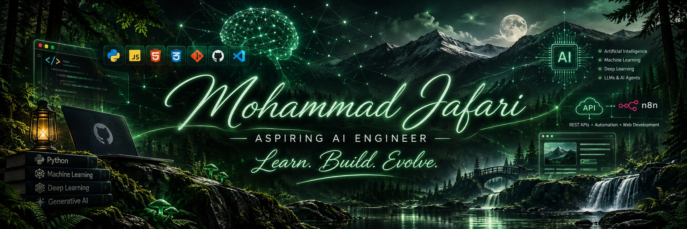

<!-- PROFILE HEADER -->

 

  

---

## 🌲 About Me

I'm an aspiring AI Engineer interested in programming, artificial intelligence, and building useful technology.

I enjoy understanding how things work, exploring new ideas, and turning knowledge into practical projects. My approach is to learn deeply, think scientifically, and improve through experimentation.

> **Learn. Build. Evolve.**

## 🧠 Areas of Interest

- Artificial Intelligence
- Machine Learning and Deep Learning
- Generative AI and Large Language Models
- AI Agents and Intelligent Systems
- Automation and Workflow Development
- API Development and Integration
- Web Development

## 🛠️ Technologies & Tools

**Programming**

**Development Tools**

### Current Learning Focus

| Technology | Current level |
|:--|:--|
| Python | Intermediate foundations |
| JavaScript | Beginner |
| HTML5 and CSS3 | Beginner |
| Git | Practical familiarity |
| GitHub | Learning |
| REST APIs | Learning |
| Artificial Intelligence | Learning |
| Machine Learning | Learning path |
| Deep Learning | Planned |
| Generative AI and LLMs | Planned |
| AI Agents | Exploring |
| n8n and Automation | Planned |

## 🚀 Featured Project

### Personal Portfolio Website

A personal website introducing my interests, skills, and projects.

**Built with:** HTML5, CSS3, and JavaScript

## 📊 GitHub Statistics

 

## 🌐 Connect With Me

---

**🌱 Always learning. Always building.**

